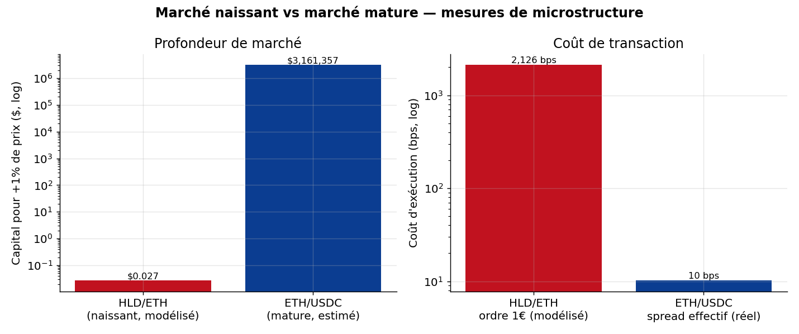
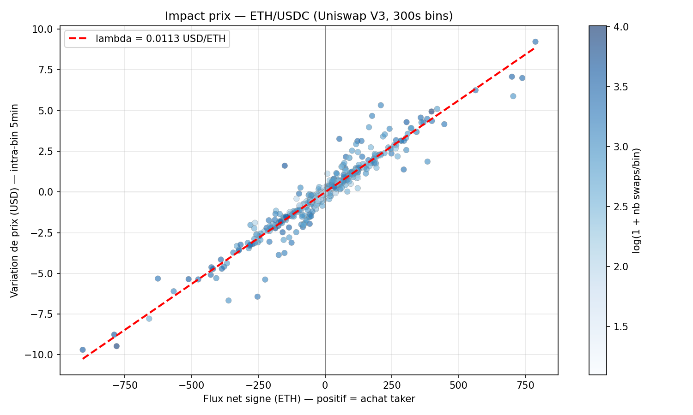

# On-Chain Market Microstructure

Liquidity and price impact of two Uniswap pools: a new, almost empty pool
(HLD/ETH, Uniswap V4 on Base) and a deep one (ETH/USDC, Uniswap V3 on
Ethereum). Python, on-chain data from July 2026.

A short note with the method and results: [note/on-chain-market-microstructure.pdf](note/on-chain-market-microstructure.pdf).

Full report (in French): [report/rapport.pdf](report/rapport.pdf)

 

## Approach

The new pool has almost no trades, so returns and volatility cannot be
estimated there. Its costs are **modelled** from its real reserves with the
constant-product formula (x * y = k). The ETH/USDC pool has thousands of
trades, so its price impact is **estimated** from real swaps.

- **HLD/ETH:** pool state read directly from the Uniswap V4 `PoolManager`
  contract with `extsload` (pool id by keccak256, storage slot, decoding of
  the packed `Slot0`), at Base block 49,023,454.
- **ETH/USDC:** 6,737 real `Swap` events over 36 hours (22-23 July 2026).
  Kyle's lambda by OLS of price changes on signed order flow, realised
  volatility, effective spread.

## Results

| | HLD/ETH (modelled) | ETH/USDC (estimated) |
|---|---|---|
| Liquidity | about $10 | several $M |
| Trades observed | about 0 | 6,737 in 36 h |
| Cost of a small order | 1 EUR order: about 2,100 bp | about 10 bp (median effective spread) |
| Capital to move the price +1% | about $0.03 | about $3.0M |
| Kyle's lambda | not estimable | 0.0116 $ per ETH per ETH (t = 317, R² = 0.94) |
| Realised volatility | not identifiable | 24.2% annualised |

The depth of the two pools differs by a factor of about 10^8.





## Run

```bash
pip install -r requirements.txt
python extract_live.py                 # HLD/ETH pool state (needs a Base RPC)
python src/extract_eth_swaps.py        # ETH/USDC swaps (needs an Ethereum RPC)
python src/microstructure.py           # estimator self-test
python src/plots.py                    # figures
jupyter notebook notebooks/analysis.ipynb
```

The extracted data is saved in `data/`, so the notebook and figures run
without an RPC.

## Limitations

- Constant product is only a local approximation of V4 concentrated
  liquidity.
- HLD costs are modelled, not observed.
- The +1% figure for ETH/USDC extrapolates lambda linearly, so it is an order
  of magnitude.
- The ETH/USDC sample covers 36 hours only.

## Structure

```
extract_live.py            HLD/ETH pool state extraction
src/onchain.py             pool id, storage slot, Slot0 decoding
src/amm.py                 constant-product model (slippage, depth, impermanent loss)
src/microstructure.py      Kyle's lambda, realised volatility, effective spread
src/extract_eth_swaps.py   ETH/USDC swap extraction
src/plots.py               figures
notebooks/analysis.ipynb   full analysis
report/rapport.pdf         report
```
